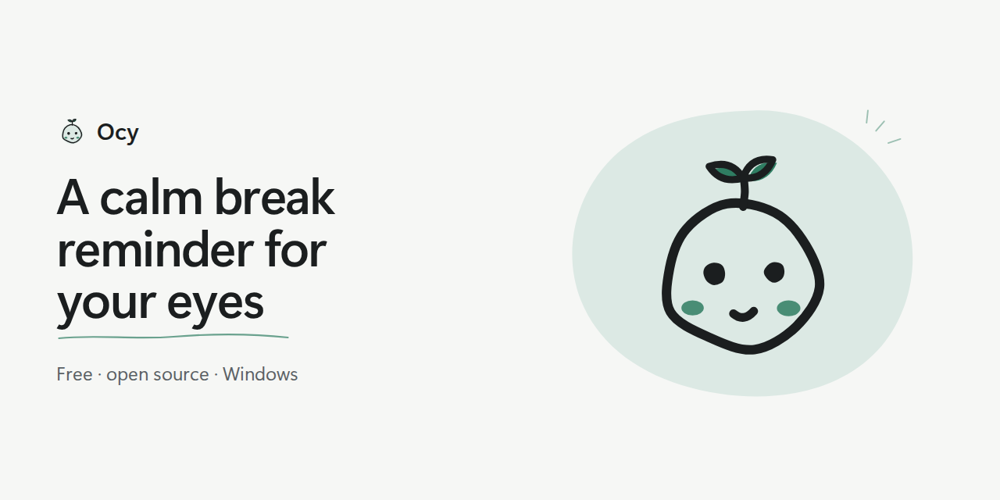
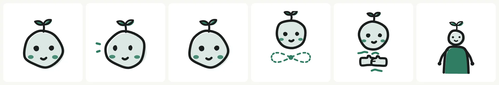
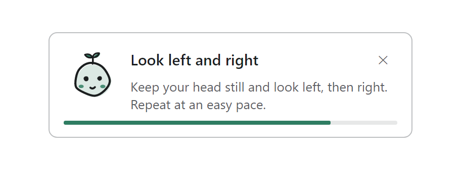
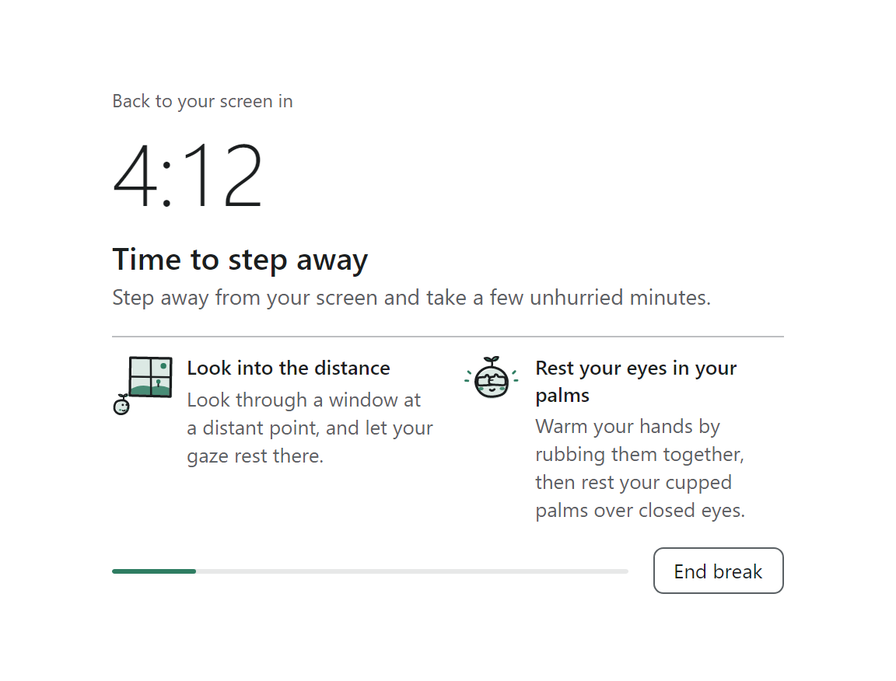
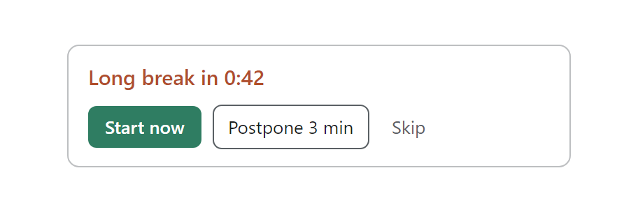
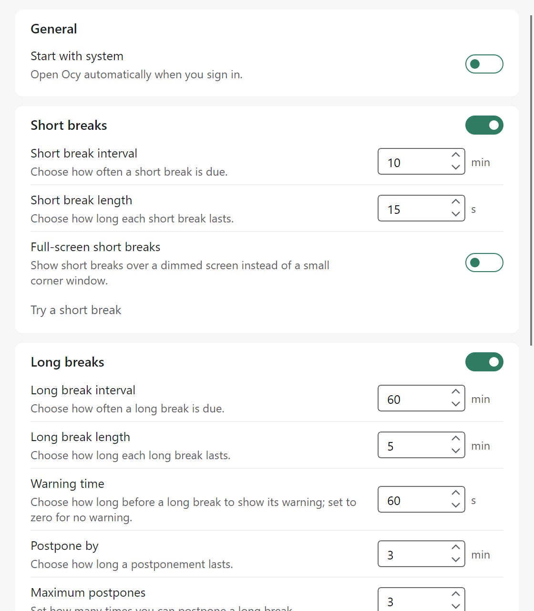

<p align="center">
  
</p>

<h1 align="center">Ocy — a calm break reminder for your eyes</h1>

<p align="center">
  <b>Short eye exercises every few minutes, a real break every hour, and quiet when you need focus.</b><br/>
  Free and open source. Lives in the tray. No account, no telemetry, nothing leaves your PC.
</p>

<p align="center">
  <a href="https://github.com/danielmevit/ocy/releases"></a>
  <a href="LICENSE"></a>
  
  
  
</p>

<p align="center">
  <a href="https://danielmevit.github.io/ocy/">Website</a> ·
  <a href="https://github.com/danielmevit/ocy/releases">Download</a> ·
  <a href="#how-it-decides-when-to-remind-you">How it works</a> ·
  <a href="CHANGELOG.md">Changelog</a> ·
  <a href="ROADMAP.md">Roadmap</a>
</p>

---

Long screen sessions dry and tire your eyes. Most of us know the advice: blink, look into the distance, get up now
and then. **Ocy is a break reminder that makes it easy to actually do it.** Every ten minutes a small card shows one
illustrated eye exercise for fifteen seconds. Every hour it asks for a real five-minute break away from the screen.
Between breaks it stays out of the way.

> **Alpha.** Ocy is in its 0.1 series: Windows first, with macOS and Linux to follow. It works day to day, and
> feedback is very welcome in [Issues](https://github.com/danielmevit/ocy/issues).

<p align="center">
  <picture>
    <source media="(prefers-color-scheme: dark)" srcset="assets/readme/exercises-dark.webp"/>
    
  </picture>
</p>

## Why Ocy

- **It shows the break where you are looking.** Short breaks and the long-break warning appear on the monitor you are
  working on. The other monitors get a soft coloured frame, so the reminder never pops up on a screen you can't see.
- **It knows when to stay quiet.** Fullscreen apps, games and presentations put breaks on hold until you are done.
- **Time away counts as rest.** Step away from the keyboard, lock the PC or put it to sleep, and Ocy counts it as a
  break. You won't come back to a "time for a break!" message.
- **Hand-drawn exercises, gently animated.** Twelve original exercises drawn in a few frames each, like a flip book.
  If Windows animations are turned off, they hold still.
- **Gentle first, firm when you want it.** A warning a minute before each long break lets you start it, postpone it a
  few times or skip it. Turn on **strict mode** and long breaks keep to the schedule.
- **Private by design.** No account, no telemetry, no ads and no network code. Settings stay in `%APPDATA%\Ocy`.
- **At home in Windows.** Light and dark themes follow your Windows setting, and the sprout tray icon matches your
  taskbar.

## Screenshots

<table>
  <tr>
    <td width="50%">
      <picture>
        <source media="(prefers-color-scheme: dark)" srcset="assets/readme/short-break-dark.png"/>
        
      </picture>
      <p align="center">Short break, on the monitor you are using</p>
    </td>
    <td width="50%">
      <picture>
        <source media="(prefers-color-scheme: dark)" srcset="assets/readme/long-break-dark.png"/>
        
      </picture>
      <p align="center">Long break, every hour</p>
    </td>
  </tr>
  <tr>
    <td width="50%">
      <picture>
        <source media="(prefers-color-scheme: dark)" srcset="assets/readme/warning-dark.png"/>
        
      </picture>
      <p align="center">A heads-up before the long break</p>
    </td>
    <td width="50%">
      <picture>
        <source media="(prefers-color-scheme: dark)" srcset="assets/readme/settings-dark.png"/>
        
      </picture>
      <p align="center">Settings apply as you change them</p>
    </td>
  </tr>
</table>

## Install

**Windows 10 or 11 (64-bit):**

1. Download `Ocy-<version>-win-x64.zip` from [Releases](https://github.com/danielmevit/ocy/releases).
2. Unzip it anywhere, for example `Documents\Ocy`, and run `Ocy.exe`. Nothing else needs installing.
3. Ocy appears in the tray as a small green sprout. Right-click it for settings, pause and quit.

The app isn't code-signed yet, so Windows SmartScreen may warn on the first run: choose **More info → Run anyway**.
To start Ocy when you sign in, turn on **Start with system** in Settings. To remove it, quit Ocy from the tray and delete
the folder, plus `%APPDATA%\Ocy` if you also want to remove your settings.

**macOS and Linux:** planned, using the same core. See the [roadmap](ROADMAP.md).

## The exercises

| Eyes | Eyes | Body |
| --- | --- | --- |
| Blink slowly | Shift near to far | Stretch your arms |
| Look left and right | Look into the distance | Loosen your shoulders |
| Look up and down | Trace a figure eight | Stand and walk |
| Roll your eyes gently | Close your eyes tightly | Rest your eyes in your palms |

All text and art are original. Each exercise is described in a sentence or two, so you can follow it without
looking at the screen.

## How it decides when to remind you

| | Default | Range |
| --- | --- | --- |
| Short break | every 10 min, for 15 s | every 2–60 min, 5–120 s |
| Long break | every 60 min, for 5 min | every 15–240 min, 1–30 min |
| Warning before a long break | 60 s | 0–300 s |
| Postpone | 3 min, up to 3 times | 1–30 min, 0–10 times |
| You count as away after | 2 min without input | 30 s – 30 min |

- The clock counts **active screen time**, not wall-clock time. Idle time, a locked screen and sleep don't count
  towards your next break.
- An absence at least as long as a break **counts as that break**. A long absence counts as a long break.
- With **Pause in fullscreen** on (the default), breaks that fall due during a fullscreen app or presentation wait
  until you leave it.
- From the tray you can **pause** for 1 hour, for 3 hours or until you resume, or **take a long break now**.

## Is Ocy an alternative to EyeLeo?

Yes. If you used EyeLeo, which hasn't been updated in years, Ocy covers the same daily routine: short eye
exercises, regular long breaks and quiet during fullscreen work. It also shows breaks on the monitor you are using,
counts time away as rest, and is built to run on Windows, macOS and Linux. Ocy is an independent project, and its
code, exercises and art are all original.

## FAQ

**Is it free?** Yes. Ocy is free and open source under AGPL-3.0, with no paid tier and no ads.

**Does it need the internet?** No. Ocy has no network code at all. It works fully offline and never phones home.

**Will it interrupt my game, video call or presentation?** Fullscreen apps and presentations hold breaks until you
are done. Detecting calls in windowed apps is on the roadmap.

**Can I make it stricter or gentler?** Yes. Change how often breaks come and how long they last, or turn off
postponing and skipping with strict mode.

**Is this medical advice?** No. Ocy is a habit tool. If your eyes hurt or your vision changes, see an eye-care
professional.

## Build from source

Requirements: the [.NET 10 SDK](https://dotnet.microsoft.com/download).

```sh
git clone https://github.com/danielmevit/ocy.git
cd ocy
dotnet build Ocy.slnx -c Release
dotnet test Ocy.slnx -c Release
dotnet run --project src/Ocy.Desktop/Ocy.Desktop.csproj -c Release
# self-contained Windows build:
dotnet publish src/Ocy.Desktop/Ocy.Desktop.csproj -c Release -r win-x64 --self-contained -o publish/win-x64
```

The solution has four projects:
- `Ocy.Core`: the break engine and settings, with no UI and no OS calls
- `Ocy.Abstractions`: small platform contracts
- `Ocy.Platform.Windows`: idle time, fullscreen, session events and the taskbar theme
- `Ocy.Desktop`: the Avalonia tray app

The engine runs on an injected clock and is covered by unit tests. The UI is tested headless. See
[docs/ARCHITECTURE.md](docs/ARCHITECTURE.md).

## Contributing

Issues and ideas are welcome. Before a larger change, open an issue so we can agree on the approach. The build must
stay at 0 warnings, and new behaviour needs tests. Project conventions are in [AGENTS.md](AGENTS.md) and
[docs/](docs/).

## License

[GNU Affero General Public License v3.0](LICENSE). Copyright © 2026 Daniel Mitev (Daniel Mevit).
Made by [damt.xyz](https://damt.xyz).

<sub>Keywords: break reminder, eye strain, eye care, eye exercises, 20-20-20 rule, rest reminder, screen time,
digital eye strain, posture and stretch reminder, tray app, Windows break timer, EyeLeo alternative, open source.</sub>
