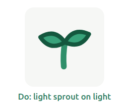
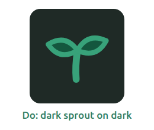
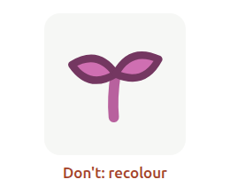
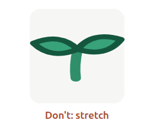
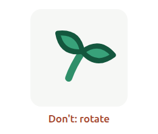
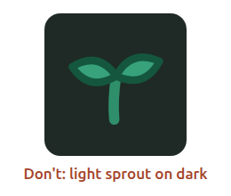

# Ocy brand kit

The Ocy name, sprout logo and character are the project's brand assets; please don't use them in a way that suggests
endorsement.

## Contents
- `logo/`: the sprout logo. SVG sources, PNG at 64 to 1024 px (`logo/png/`) and vector PDFs (`logo/pdf/`, open in
  Illustrator and other vector editors).
  - `ocy-sprout-light.svg`: for light or white backgrounds.
  - `ocy-sprout-dark.svg`: for dark backgrounds.
  - `ocy-sprout-light-dark-stem.svg`: the light sprout with a deep-jade stem, used on the Store art.
  - `ocy-logo-mark.svg`: the sprout on the white rounded tile.
  - `ocy-lockup-on-light.svg`, `ocy-lockup-on-dark.svg`: tile + "Ocy". The wordmark is live text (font-family
    `Segoe UI`, then free fallbacks), not outlines; PNG exports are in `logo/png/`. There is no lockup PDF, because a PDF
    would embed Segoe UI glyphs.
- `character/`: `ocy-character.svg` (the character as drawn in the app's exercise art) and
  `ocy-character-deep-approved-direction.svg` (approved direction, final art pass pending: deep-jade outline, attached
  leaf crescents, stem ending inside the head, face filled to the outline). PNG and PDF exports alongside.
- `color/`: `palette.md`, `tokens.css`, `tokens.json`, `swatches.png` / `swatches.pdf`.
- `backgrounds/`: background G as CSS (`gradient-g.css`) and PNG at 3840x2160 and 1920x1080.
- `store/`: the final Microsoft Store art (box art, poster art, app tiles, logo mark).
- `usage/`: the do and don't examples below.
- `tools/brand-kit.mjs`: regenerates every export from the SVG sources.

## Using the logo
- The logo is the sprout. Use the light-background sprout on light or white, the dark-background sprout on dark.
- Never recolour, stretch or rotate it.
- Clear space: keep at least the tile's corner radius (about a quarter of the mark's width) free on every side.
- Minimum size: 24 px.

| | |
| --- | --- |
|  |  |
|  |  |
|  |  |

## Typeface
The app uses the system font, Segoe UI, on Windows. Segoe UI is a Microsoft font: it ships with Windows and may not be
redistributed, so this kit never embeds it (live text only in SVGs, no Segoe in PDFs). On other platforms use a free
humanist sans: Ubuntu Sans or Noto Sans (SIL Open Font Licence / Ubuntu Font Licence), then the system sans-serif.

## Regenerating
`NODE_PATH=<node_modules with playwright> node assets/brand-kit/tools/brand-kit.mjs`
(Playwright with its Chromium is the only requirement; it is not a repo dependency.)
